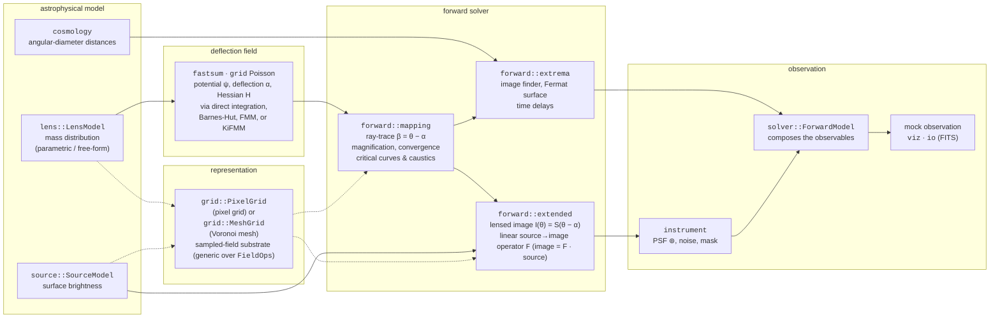
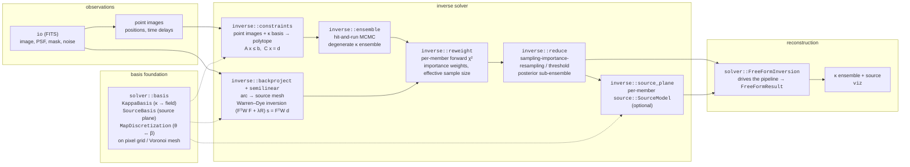

<!--
SPDX-FileCopyrightText: 2025-present Philipp Denzel <phdenzel@gmail.com>
SPDX-FileNotice: Part of lens-forge
SPDX-License-Identifier: GPL-3.0-or-later
-->

<p align="center">
  
</p>

[](https://github.com/phdenzel/lens-forge/actions/workflows/ci.yml)
[](https://codecov.io/gh/phdenzel/lens-forge)
[](https://phdenzel.github.io/lens-forge/)
[](https://www.gnu.org/licenses/gpl-3.0)
[](https://arxiv.org/abs/XXXX.XXXXX)

A blazingly fast Rust-based gravitational-lens modelling library.

`lens-forge` targets **both** strong-lensing use cases:

- **Forward simulation** — given a lens mass distribution and a source, produce
  lensed images, magnification maps, critical curves, caustics, time delays,
  and PSF/noise-convolved mock observations.
- **Inverse reconstruction** — given observed lensed images (with PSF and noise),
  reconstruct the lens mass and/or source light, including a degenerate-solution
  **ensemble** in the free-form tradition.

Both the lens and the source support **parametric** (analytic profiles) and
**free-form** (pixelated grid / Voronoi mesh) representations behind a common
trait, so solvers, rendering, and inference are agnostic to the underlying
representation.

> **Status:** active development. The numerical, visualization, and I/O
> foundations and the physics core (lens / source / cosmology / instrument) are
> in place and the forward solver is complete; the inverse/ensemble
> reconstruction and the CLI are being built out.


## Build

A **nightly** toolchain is required. A Nix flake pins the toolchain (via fenix)
and provides all system dependencies (Vulkan/Metal, `libiconv`, X11/Wayland on
Linux):

```sh
nix develop                                          # enter the dev shell
cargo build --all-targets --locked
```

Without Nix, install a matching nightly Rust and ensure the platform equivalents
of the flake's `buildInputs` are available to the linker (notably `libiconv` on
macOS). Nightly is needed because the `phastft` dependency uses
`#![feature(portable_simd)]`, and the viewer additionally needs `wgpu`/`winit`
system deps.


### Tests

You can run the testing suite with
```sh
nix develop --command cargo test --locked
```


### Coverage

Code coverage is evaluated using the LLVM source-based code coverage tool
```sh
nix develop --command cargo llvm-cov --locked        # coverage
```


### Examples

Example usage files using the library can be inspected in `examples/` and 
executed as follows

```sh
cargo run --example pixelgrid_viz
cargo run --example meshgrid_viz
cargo run --example meshgrid_texturize
cargo run --example gradient_viz
```


## Command-line interface

`lens-forge` ships a multi-binary CLI. The `lens-forge` command (also available
as the short alias `lf`) dispatches to per-subcommand binaries (`lf-<name>`), 
forwarding arguments and propagating exit codes.

```sh
lf --help                       # top-level usage and subcommands
lf fits image.fits              # print a whole-file metadata summary
lf fits image.fits --header     # print the selected HDU's header cards
lf fits image.fits --plot --cmap magma --scale log10     # interactive viewer
lf fits image.fits -o out.png --cmap turbo --width 1024  # headless render
```

The `fits` subcommand inspects or renders a FITS image, reusing the `viz` raster
and viewer paths (colour map, linear/log/symlog scaling, normalization bounds,
resampling filter).


## Architecture

The crate is composed of many submodules, each with its own `mod.rs` doc.
The layers summarize as follows:

- **`grid`** — geometry (`Point2D`, `BBox`) and sampled scalar fields behind the
  `ScalarField2D`/`FieldOps` traits. Two implementations share the contract:
  `PixelGrid` (structured, with finite-difference and spectral/FFT operators)
  and `MeshGrid` (unstructured Voronoi, with finite-volume operators). Generic
  `T: FieldOps` code runs on either.
- **`fastsum`** — free-space N-body summation of the 2D lensing Green's function.
  Every backend evaluates the same `Jet` (ψ, deflection α, Hessian H) at a query
  point behind the `Summation` trait: exact `DirectSum`, `BarnesHut`, analytic
  2D `Fmm`, and kernel-independent `Kifmm`.
- **`cosmology`** — the physical-scales boundary layer: redshifts + a background
  model → angular-diameter distances and lensing scalings, with SI/astrophysical
  units and Planckian-unit conversions in `cosmology::units`.
- **`lens` / `source`** — the astrophysical model behind the `LensModel` and
  `SourceModel` traits. Parametric profiles and free-form fields are
  interchangeable; free-form lenses (`PixelLens`, `MeshLens`) select a
  `FieldMethod` (analytic square/polygon kernels or a fastsum backend).
- **`instrument`** — how the sky is observed, orthogonal to the model: PSF, noise
  covariance, and mask, shared by forward imaging and every inverse likelihood.
- **`solver`** — lens-equation solvers over a shared basis foundation. `forward`
  turns (lens, source) into observables; `inverse` turns observables into a
  free-form mass ensemble and reconstructed source.
- **`io`** — loading/saving external data as field types; currently a from-scratch
  FITS image reader/writer.
- **`viz`** — colour mapping, scaling, rasterization, and a live `winit`/`wgpu`
  viewer.


### Pipeline

How the modules compose in each direction:

**Forward: (lens, source) → observables**



**Inverse: observables → mass ensemble → source**




## Benchmarks

Performance is tracked with [Criterion](https://github.com/bheisler/criterion.rs)
(statistical benchmarking with HTML reports written to `target/criterion/`; open
`target/criterion/report/index.html` to compare methods within a suite).

```sh
cargo bench                          # all suites, quick representative sweep
cargo bench --features full-bench    # exhaustive sweep (all sizes/stencils; slow)
cargo bench --bench pixelgrid_ops    # run one suite
cargo bench -- pixelgrid/gradient    # filter by benchmark id
```

Benches that support it run a small representative subset by default; the
`full-bench` feature widens their parameter sweep for a thorough (but much
slower) run.

| Bench | Measures |
| --- | --- |
| `viz_scale` | Throughput of the `viz` render-scaling (`RenderScale`: linear/log10/symlog) and `Normalize` operations, comparing five strategies — per-value, slice, in-place, and their Rayon-parallel slice/in-place variants — across array sizes (100 up to 1M under `full-bench`). Locates the serial/parallel crossover per mode: parallel never pays off for the cheap linear/normalize paths, and crosses ~30k for the transcendental log10/symlog modes — which sets `RenderOptions::threshold_parallel`. Also times `auto_range`, the serial min/max reduction behind range determination. |
| `pixelgrid_ops` | Throughput of `PixelGrid` operators. **Gradient/Laplacian:** FD central stencils (2nd/4th/6th order) vs their FD-equivalent spectral counterparts vs the *exact* spectral derivative, over 64²–256². For the *same* discrete operator FD wins (spectral does an FFT to get the same numbers); the exact-spectral route is the one that buys accuracy (~10 orders of magnitude on smooth periodic data — see the tests in `src/grid/uniform/spectral.rs`). **Poisson (`∇²ψ = f`):** one FFT divide-by-`−k²` vs a finite-difference conjugate-gradient solve — the regime where the FFT wins decisively (~11× at 64², widening with size). **Interp:** serial vs Rayon-parallel bilinear resampling at a raster of query points. |
| `meshgrid_ops` | Throughput of `MeshGrid` (unstructured Voronoi) construction and operators, swept over site counts. **Build:** full mesh construction (Bowyer–Watson triangulation + the dual Voronoi tessellation and adjacency) from a raw site cloud. **Gradient/Laplacian:** the two-point-flux finite-volume operators on a smooth field. **Poisson (`∇²ψ = f`):** a Jacobi-preconditioned CG solve (Dirichlet). **Interp:** barycentric resampling at a raster of query points, serial vs Rayon-parallel. Sites are centre-concentrated, mirroring an adaptive lensing mesh. |
| `meshgrid_locate` | Point-location throughput for `MeshGrid`: a cold `O(log n)` k-d tree query per point vs a warm-start greedy walk on the Voronoi adjacency, each under two query orderings — a coherent **raster** scan (the `viz` render hot path, the walk's best case) and **scattered** random points (where the walk degrades toward `O(√n)` and the cold tree wins). Swept over site counts. |
| `fastsum_backends` | Head-to-head speed of the fast-summation backends (`DirectSum`, `BarnesHut`, `Fmm`, `Kifmm`) for the lensing deflection field. Times both the build (tree/precompute) and a batched query over a 64×64 grid of targets, sweeping source counts (1k–16k under `full-bench`); the exact `O(N²)` direct sum is skipped above 5k to bound the run. Accuracy is verified separately in the unit tests — this suite is speed only. |
| `raytrace_batch` | Per-point vs batched ray-tracing of an image-plane grid to the source plane, per `(backend, target-count)`. The **`per-point`** loop calls `ray_trace` once per target; **`batched`** runs one `RayTracer::Direct.trace` over all targets. The gap tracks the `jet_batch` override: `spectral` parallelizes the interpolation (rayon), the fastsum backends reuse the tree across the batch, and a parametric lens is the null baseline. `--features full-bench` widens the target-count sweep. |


## License

GPL-3.0-or-later. Copyright © 2025-present Philipp Denzel.
